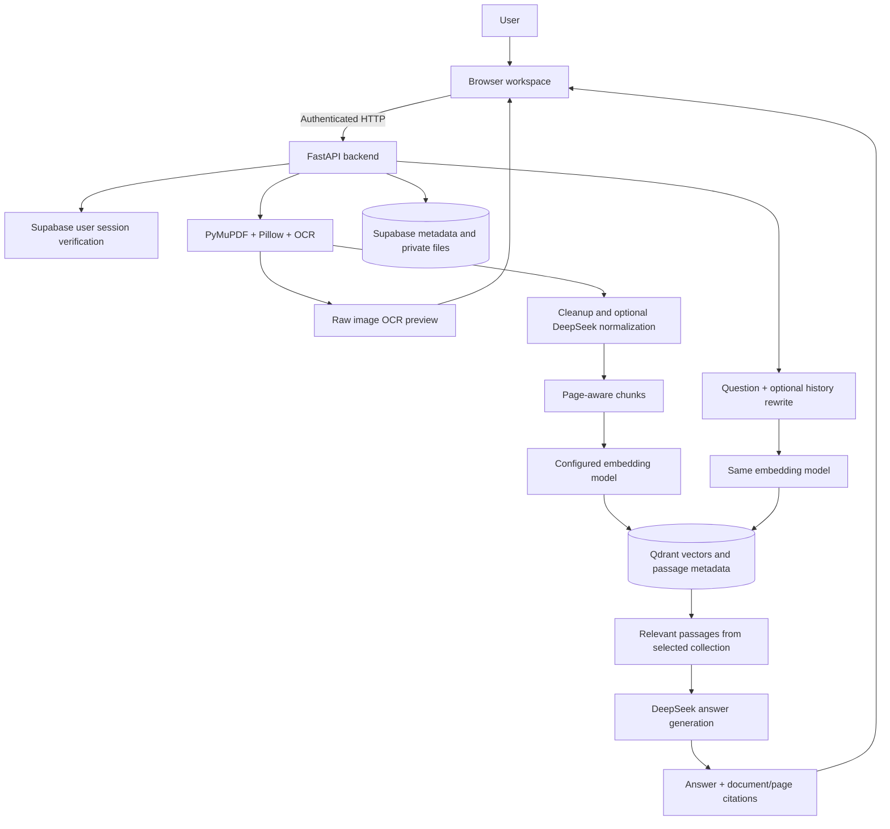
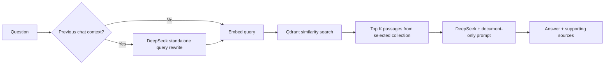

# Query Assistant | Backend

Query Assistant helps users find and understand information stored in <span style="color: #8ecbff;"><strong>PDFs, scanned documents and images</strong></span> by asking questions in <span style="color: #8ecbff;"><strong>natural language</strong></span>. It extracts readable text, recognizes image text through <span style="color: #8ecbff;"><strong>OCR</strong></span>, organizes the content into a <span style="color: #8ecbff;"><strong>searchable knowledge base</strong></span> and retrieves relevant passages to generate answers with <span style="color: #8ecbff;"><strong>document and page references</strong></span>. The project can support <span style="color: #8ecbff;"><strong>customer-service teams</strong></span> searching policies, <span style="color: #8ecbff;"><strong>students</strong></span> reviewing study notes, <span style="color: #8ecbff;"><strong>researchers</strong></span> exploring reports and users locating clauses in legal documents. By keeping related documents in separate knowledge bases and showing both extracted text and <span style="color: #8ecbff;"><strong>supporting sources</strong></span>, it reduces manual searching and makes the information behind an answer easier to inspect.

**Turn PDFs and images into searchable knowledge, then answer questions with document and page citations.**

This repository contains the FastAPI API, OCR, retrieval-augmented generation (RAG), authentication and storage integrations. The [frontend](../Query-Assistant-frontend/README.md) provides the browser workspace.

> **Upload → Extract/OCR → Clean → Chunk → Embed → Store → Retrieve → Answer with sources.** Documents are indexed separately from questions; another question does not run OCR again.

## Contents

- [Current implementation](#current-implementation)
- [Architecture and data flow](#architecture-and-data-flow)
- [Models and responsibilities](#models-and-responsibilities)
- [API keys and credentials](#api-keys-and-credentials)
- [Supported files and OCR preview](#supported-files-and-ocr-preview)
- [Setup and runtime modes](#setup-and-runtime-modes)
- [Configuration reference](#configuration-reference)
- [API reference](#api-reference)
- [Storage and isolation](#storage-and-isolation)
- [Project structure](#project-structure)
- [Verification](#verification)
- [Troubleshooting](#troubleshooting)
- [Presentation notes](#presentation-notes)

## Current implementation

This is the development configuration inspected on **9 November 2026**. Deployed environment variables must be checked separately. No secret values are included.

| Layer | Current selection | Responsibility |
| --- | --- | --- |
| Browser | HTML, CSS, native JavaScript | Login, selection, uploads, OCR preview, chat and passage search |
| HTTP backend | FastAPI + Uvicorn | Authenticate requests, validate input and coordinate processing |
| Document storage | Supabase private Storage | Persist uploaded PDFs; images are normalized internally to PDFs |
| Metadata | Supabase Postgres | Knowledge-base names, document status, progress and processing leases |
| Image decoder | Pillow `>=11.3` | Decode supported images, correct orientation and flatten transparency |
| PDF extraction | PyMuPDF | Read text layers/images and render scans for OCR |
| OCR | Tesseract through `pytesseract`, language `eng` | Recognize image text; current cloud-storage setup selects `OCR_PROVIDER=tesseract` on this Python host |
| Language model | DeepSeek `deepseek-chat` | Optional text normalization, follow-up query rewriting and final answers |
| Embedding model | OpenRouter `nvidia/nemotron-3-embed-1b:free` | Convert passages and questions into current configured **2048-dimensional** vectors |
| Vector storage | Remote Qdrant | Search relevant passages within the selected knowledge base |

Customer Support and Legal Assistant are **personas using the same configured models**, not separately trained models. Custom knowledge bases use the same pipeline with their own document collections.

## Architecture and data flow

### System architecture



### Document ingestion: upload once, search repeatedly

| Step | Component | Input → output / purpose |
| --- | --- | --- |
| 1. Authenticate and select | Middleware + `domains.py` | User session and knowledge-base key → selected workspace |
| 2. Validate | `api_server.py`, `extract.py` | File → checked extension, actual readability, size and decoding limits |
| 3. Identify | SHA-256 | Original file bytes → content hash for duplicate detection |
| 4. Extract | PyMuPDF + Tesseract, or configured OCR API | Digital text/images/scans → page-numbered text |
| 5. Preserve preview | Registry / private PDF preview artifact | Raw image OCR → text visible before LLM normalization |
| 6. Normalize | `clean.py`, optionally DeepSeek | Extracted content → merged text and structured sections; rule-based fallback |
| 7. Chunk | `chunk.py` | Clean sections → passages with filename, page and heading metadata |
| 8. Embed | `embed.py` | Passage text → vectors; local ingestion also removes near-duplicate vectors |
| 9. Index and finish | Qdrant + registry / Supabase | Vectors and metadata → searchable document and processing report |

**Local storage mode** runs ingestion in a background thread and streams activity events. **Supabase mode** saves a job and processes one page per `/step` request. Leases and cached page chunks support retries; incomplete cloud documents are excluded from search until ready.

### Question answering



If rewriting fails, retrieval uses the original question. **Search passages** uses query embedding and retrieval without generating an LLM answer. The answer prompt requests document-grounded responses, citations and the question's language; this does not guarantee generated text is error-free.

## Models and responsibilities

| Model / engine | Used where | Task | Activation / configuration |
| --- | --- | --- | --- |
| DeepSeek `deepseek-chat` | `clean.py` → `llm.py` | Optional normalization into structured sections | `DEEPSEEK_MODEL`; **Use LLM normalization**; rule-based fallback available |
| DeepSeek `deepseek-chat` | `answer.py` → `llm.py` | Resolve follow-ups into standalone retrieval queries | When chat history is supplied; falls back to original question |
| DeepSeek `deepseek-chat` | `answer.py` → `llm.py` | Answer from retrieved excerpts and select supporting sources | `DEEPSEEK_API_KEY`, `DEEPSEEK_BASE_URL`, `DEEPSEEK_MODEL` |
| NVIDIA `nvidia/nemotron-3-embed-1b:free` through OpenRouter | `embed.py` → `APIEmbedder` | Current passage/query embeddings, configured at `2048` dimensions | `EMBEDDING_API_MODEL`, `EMBEDDING_API_URL`, `EMBEDDING_DIMENSIONS`; provider availability is external |
| `intfloat/multilingual-e5-small` | `embed.py` → local `Embedder` | Alternative local embeddings through Sentence Transformers; uses `passage:` / `query:` prefixes | Default `EMBEDDING_MODEL` when `EMBEDDING_PROVIDER=local`; **not active in the current cloud configuration** |
| Tesseract OCR | `extract.py`, cloud path in `cloud.py` | Recognize characters in images; does not generate conversational answers | Current host OCR; Supabase mode selects it with `OCR_PROVIDER=tesseract` |
| Mistral-compatible `mistral-ocr-latest` | `cloud.py` | Alternative hosted OCR for image/scanned PDF pages | Cloud default when `OCR_PROVIDER` is unset; requires `OCR_API_KEY`; **not active in current Tesseract setup** |

PyMuPDF, Pillow, FastAPI, Supabase and Qdrant are tools/services, not language models. The `openai` Python package is a client for DeepSeek's compatible API; it does not mean a GPT model or OpenAI API key is used.

## API keys and credentials

Provider secrets are read **only by the backend** from `.env` or server environment. This table lists names, never actual key values.

| Variable | Service | Used in | Purpose | Required when |
| --- | --- | --- | --- | --- |
| `DEEPSEEK_API_KEY` | DeepSeek | `llm.py` | Authenticate cleanup, rewrite and answer requests | Generated answers; LLM cleanup when enabled |
| `EMBEDDING_API_KEY` | Embedding API; currently OpenRouter | `embed.py` | Authenticate passage and query embeddings | `EMBEDDING_PROVIDER=api` |
| `SUPABASE_SERVICE_ROLE_KEY` | Supabase | `cloud.py`, indirectly domain persistence | Server access to metadata, private files and processing RPCs | `STORAGE_BACKEND=supabase`; use the configured service-role credential, not a browser anon key |
| `QDRANT_API_KEY` | Remote Qdrant | `vectorstore.py` | Authenticate vector writes, search and deletion | Remote instance requires credentials |
| `OCR_API_KEY` | Mistral-compatible OCR provider | `cloud.py` | Authenticate remote OCR | Cloud API OCR only; not required for Tesseract |
| `SUPABASE_ANON_KEY` + `AUTH_COOKIE_SECRET` | Application login | `user_auth.py`, API middleware | Supabase Auth and signed cookie sessions | Backend only; see [AUTH_SETUP.md](AUTH_SETUP.md) |
| No API key | Tesseract | `extract.py` | Host OCR inference | Executable, `pytesseract` and language data required |
| No API key | Local Sentence Transformers | `embed.py` | Local embedding inference | Local dependencies and initial model availability required |

Service URLs identify endpoints; they do not replace credentials. A DeepSeek key is not used for OpenRouter embeddings. The frontend's `BACKEND_URL` is a **public URL**, not a secret.

### Authentication and browser session

Every RAG route, including health and API documentation, is protected. Admin login, user signup/login/refresh/logout and CORS preflight are reachable before login. Missing Auth configuration returns HTTP 503; invalid/expired sessions return HTTP 401. Use HTTPS when deployed.

Existing admin credentials in `.env` work through **Admin sign in**, without a Supabase account. Supabase Auth manages other users? email/password accounts and password hashes. HttpOnly cookies hold the access JWT (15-minute app limit) and rotating refresh token; a signed session deadline enforces seven days. Logout revokes the refresh session and clears cookies. Profiles live in `public.users` with row-level security. RAG knowledge bases and documents are private to each account; existing data stays with admin. Run the required [workspace migration](WORKSPACE_ISOLATION.md) before deploying. Complete the required [authentication setup](AUTH_SETUP.md), including the SQL migration and Supabase JWT expiry setting.

## Supported files and OCR preview

| Input | Extraction behavior |
| --- | --- |
| `.pdf` | Extract text layer; OCR embedded images/scanned content when needed |
| `.jpg`, `.jpeg`, `.jfif` | Decode JPEG and run OCR |
| `.png` | Decode, flatten transparency onto white and run OCR |
| `.webp` | Decode WebP and run OCR |
| `.bmp` | Decode bitmap and run OCR |
| `.tif`, `.tiff` | Decode and OCR every TIFF page |
| `.avif` | Decode AVIF and run OCR; needs a Pillow build with AVIF support |

Limits: **4,000,000 bytes per upload**, **500 PDF/TIFF pages**, **50 million total decoded image pixels**. Animated PNG/WebP/AVIF use the first frame. Pillow `>=11.3` is declared for AVIF support in standard wheels. OCR quality depends on text size, contrast, orientation and installed language data.

Raw image text appears in a **soft golden panel** with **EXTRACTED FROM IMAGE**, filename and **View text** access for saved images. This is the original OCR output, not LLM-cleaned text. Browser rendering uses `textContent`, not executable HTML.

In Supabase mode, uploaded images are normalized to PDFs. Exact UTF-8 OCR is stored as attachments in a separate `.ocr.pdf` artifact, compatible with the **PDF-only private bucket**. TIFF previews retain every page; retries replace that page's text. Document deletion also removes previews. No bucket MIME expansion or database migration is required for these image formats.

## Setup and runtime modes

### Requirements

- Python **3.12** for the declared packaging range (`>=3.12,<3.13` in `pyproject.toml`).
- Core packages from `requirements.txt`, including Pillow `>=11.3`.
- `requirements-local.txt` for local embeddings, `pytesseract`, Streamlit and sample tools.
- Tesseract executable and installed language data for host OCR.
- Credentials and service access for the selected runtime mode.

| Mode | Settings | Persistent data | OCR |
| --- | --- | --- | --- |
| Local storage/embeddings | `STORAGE_BACKEND=local`, `EMBEDDING_PROVIDER=local` | Disk files/registries; embedded Qdrant when `QDRANT_URL` is empty | Tesseract |
| Supabase on a Python host | `STORAGE_BACKEND=supabase`, `EMBEDDING_PROVIDER=api` | Supabase + remote Qdrant | Host Tesseract with `OCR_PROVIDER=tesseract`, or OCR API |
| Lightweight Vercel backend | Supabase + API embeddings | Supabase + remote Qdrant | OCR API unless runtime separately includes Tesseract |

The **current development setup combines Supabase storage, API embeddings and host Tesseract**. Cloud storage does not require OCR to be remote.

### Local setup: Windows PowerShell

Run inside `Query-Assistant-backend`:

```powershell
python -m venv .venv
.\.venv\Scripts\python.exe -m pip install -r requirements.txt
.\.venv\Scripts\python.exe -m pip install -r requirements-local.txt
Copy-Item .env.example .env
```

Copy the example only for a **new installation**; retain an existing configured `.env`. Complete [authentication setup](AUTH_SETUP.md), then configure `DEEPSEEK_API_KEY` and Tesseract. For local storage, select:

```dotenv
STORAGE_BACKEND=local
EMBEDDING_PROVIDER=local
EMBEDDING_MODEL=intfloat/multilingual-e5-small
QDRANT_URL=
OCR_LANG=eng
```

Start the current API:

```powershell
.\.venv\Scripts\python.exe -m uvicorn api_server:app --port 8000 --reload
```

On macOS/Linux, create/activate a virtual environment, install the same requirements and use `python -m uvicorn api_server:app --port 8000 --reload`. Install Tesseract through the OS package manager and remove a Windows-specific executable path when using PATH detection.

### Supabase setup

Use `.env.cloud.example` as a configuration reference. Run [supabase/setup.sql](supabase/setup.sql) in the intended project; configure private storage, embedding API, remote Qdrant and [Supabase authentication](AUTH_SETUP.md). On a Tesseract host install `requirements-local.txt` and select `OCR_PROVIDER=tesseract`; otherwise configure `OCR_API_KEY`. See [DEPLOY_VERCEL.md](DEPLOY_VERCEL.md) for cloud deployment.

| Resource | Development URL |
| --- | --- |
| Frontend | `http://localhost:3000` |
| Authenticated health | `http://localhost:8000/api/health` |
| Swagger UI | `http://localhost:8000/docs` |
| OpenAPI schema | `http://localhost:8000/openapi.json` |

Use **`api_server:app`** for the browser frontend. `api.py` is a compatibility entrypoint for the same authenticated API; obsolete shared-workspace routes are removed. `--reload` is for development; restart manually after environment changes to ensure settings are loaded.

## Configuration reference

| Variable | Code default | Purpose |
| --- | --- | --- |
| `STORAGE_BACKEND` | `local`; `supabase` when `VERCEL` is set | Metadata/file persistence mode |
| `EMBEDDING_PROVIDER` | `api` in Supabase mode; otherwise `local` | Embedding implementation |
| `EMBEDDING_API_URL` | Empty | Full compatible `/embeddings` endpoint |
| `EMBEDDING_API_MODEL` | Empty | Exact provider model identifier |
| `EMBEDDING_DIMENSIONS` | `0` | Required actual API output dimension |
| `EMBEDDING_MODEL` | `intfloat/multilingual-e5-small` | Alternative local embedding model |
| `DEEPSEEK_BASE_URL` | `https://api.deepseek.com` | LLM base URL |
| `DEEPSEEK_MODEL` | `deepseek-chat` | Cleanup, rewrite and answer model |
| `OCR_PROVIDER` | `api` in cloud OCR path | Select `tesseract` for Supabase with host OCR; local extraction uses Tesseract |
| `OCR_API_URL` | `https://api.mistral.ai/v1/ocr` | Hosted OCR endpoint |
| `OCR_API_MODEL` | `mistral-ocr-latest` | Hosted OCR model |
| `TESSERACT_CMD` | Auto-detected | OCR executable path; standard Windows path is checked |
| `OCR_LANG` / `OCR_PSM` | `eng` / `6` | Language data/default segmentation; whole-page/image OCR uses PSM `3` |
| `MIN_IMAGE_PIXELS` | `120` | Embedded-PDF-image filtering threshold |
| `SUPABASE_URL` | Empty | Supabase project URL |
| `SUPABASE_BUCKET` | `knowledge-pdfs` | Private file bucket |
| `QDRANT_URL` | Empty | Remote vector server; empty uses embedded storage in local mode |
| `CORS_ORIGINS` | localhost and 127.0.0.1 on port `3000` | Comma-separated allowed frontend origins |
| `CHUNK_CHARS` / `CHUNK_OVERLAP_CHARS` | `1000` / `150` | Target passage size/overlap in characters, not tokens |
| `TOP_K` | `5` | Retrieval count; HTTP UI accepts 1–20 |
| `NEAR_DUPLICATE_THRESHOLD` | `0.97` | Local-ingestion cosine similarity cutoff |

Secret variables are documented in the credentials table. Passage and query vectors must use the same model/dimensions. Changing API embedding configuration changes the cloud namespace; existing vectors are not automatically migrated.

## API reference

All RAG routes require a user session. Auth mutations require `X-CSRF-Protection: 1` and an allowed browser origin.

| Method | Endpoint | Purpose |
| --- | --- | --- |
| POST | `/api/auth/admin/login` | Existing admin username/password login |
| POST | `/api/auth/signup` | Create name/email/password account |
| POST | `/api/auth/login` | Sign in and set HttpOnly cookies |
| POST | `/api/auth/refresh` | Rotate refresh token and renew access |
| POST | `/api/auth/logout` | Revoke session and clear cookies |
| GET | `/api/auth/session` | Return the authenticated user profile |
| GET | `/api/health` | Configuration flags; not a complete service connectivity check |
| GET | `/api/domains` | List built-in/custom bases |
| POST | `/api/domains` | Create base with `{"name":"Research Notes"}` |
| PATCH | `/api/domains/{key}` | Rename custom base |
| DELETE | `/api/domains/{key}` | Delete custom base and its content |
| GET | `/api/domains/{key}/status` | Ready/pending files and passage counts |
| POST | `/api/domains/{key}/ingest` | Upload or process/resume saved files |
| POST | `/api/domains/{key}/documents/{file_hash}/step` | Process next cloud page |
| GET | `/api/domains/{key}/documents/{file_hash}/text` | Read image's raw OCR preview |
| DELETE | `/api/domains/{key}/documents/{file_hash}` | Remove document, vectors and preview |
| POST | `/api/domains/{key}/ask` | Retrieve and generate cited answer |
| POST | `/api/domains/{key}/search` | Retrieve passages without generation |
| POST | `/api/domains/{key}/reset` | Local reset; disabled in Supabase mode |

### Request and response contracts

Ingestion uses multipart `file` (optional), `force=false`, `use_llm=true`.

| Mode | Response | Client behavior |
| --- | --- | --- |
| Local | NDJSON `log`, `done`, `error` events | Read through completion; inspect errors even after HTTP 200 |
| Supabase | JSON `{"jobs":[...]}` | Call each `/step` until `ready`; resume after interruption |

Cloud rebuilds use document deletion/re-upload; local forced ingestion uses `force=true`. Omitting `file` processes saved local files or resumes pending cloud jobs.

Ask with `{"question":"What is the return period?","history":[],"top_k":5}`. Response fields: `answer`, cited `sources`, retrieval `query`, raw `hits`. Sources contain text, similarity scores and filename/page/heading metadata. Search accepts `{"query":"return period","top_k":5}` and returns `hits`. Preview returns `{"name":"notes.png","text":"Recognized text..."}`.

## Storage and isolation

| Data | Local storage mode | Supabase storage mode |
| --- | --- | --- |
| Source uploads | `pdfs/<base>/` | Private bucket; images normalized to PDFs |
| Custom base names | `data/custom_domains.json` | `qa_domains` |
| Registry/progress | `data/registry.json` | `qa_documents` + claim/advance/release RPCs |
| Extraction/normalization cache | `data/cache/` | Temporary cleanup cache and durable cached page chunks |
| Raw image OCR preview | Image report in registry | UTF-8 attachments in private `.ocr.pdf` artifact |
| Vectors + searchable text/metadata | Embedded or remote Qdrant | Remote Qdrant; namespace-qualified collections |
| Conversation | Browser memory | Browser memory; not persisted in Supabase |

Each account/base has its own vector collection. The paths above are legacy admin paths; other users have separate workspace paths/namespaces, described in [WORKSPACE_ISOLATION.md](WORKSPACE_ISOLATION.md). SHA-256 identifies file content. Renaming preserves the internal key and content. Document/base deletion is scoped to that selection. Built-in assistants cannot be renamed/deleted as custom bases.

Local Qdrant has a **single-process lock**: run API, Streamlit or CLI against that folder one at a time. Back up local `pdfs/` and `data/` together. Remote Qdrant does not replace source-file or registry backups.

## Project structure

```text
Query-Assistant-backend/
├── api_server.py          # Current authenticated frontend API
├── api.py                 # Alias for the authenticated API
├── app.py                 # Alternative Streamlit UI
├── cli.py                 # Command-line interface
├── src/rag/
│   ├── config.py          # Environment configuration
│   ├── user_auth.py       # Supabase Auth and cookie sessions
│   ├── domains.py         # Personas and custom bases
│   ├── extract.py         # Validation, image decoding, PDF extraction, OCR
│   ├── clean.py           # Rule-based / LLM normalization
│   ├── chunk.py           # Page-aware passages
│   ├── embed.py           # API/local embeddings
│   ├── vectorstore.py     # Qdrant operations
│   ├── ingest.py          # Local ingestion and registry
│   ├── cloud.py           # Supabase jobs, cloud OCR and preview persistence
│   ├── llm.py             # DeepSeek-compatible client
│   └── answer.py          # Rewrite, retrieval and answers
├── supabase/setup.sql     # Schema, RPCs and private PDF bucket
├── pdfs/                  # Local uploads and bundled files
├── data/                  # Local runtime state
├── tests/                 # Validation and regression coverage
├── requirements.txt       # Core/API dependencies
├── requirements-local.txt # Local models, OCR and tools
└── DEPLOY_VERCEL.md        # Cloud deployment guide
```

Optional local interfaces: `python cli.py status`, `python cli.py ingest -d customer_support --no-llm`, `python cli.py ask -d customer_support "What is the delivery policy?"`, `streamlit run app.py`. The browser is the primary interface for custom-base management and cloud jobs.

## Verification

Select local test mode before offline discovery in PowerShell:

```powershell
$env:STORAGE_BACKEND='local'
$env:EMBEDDING_PROVIDER='local'
.\.venv\Scripts\python.exe -m unittest discover -s tests -p 'test_*.py'
```

Fixtures isolate runtime data and mock external services. Coverage includes authentication, ingestion, retries, deletion, custom bases, preview text, PDF-only bucket compatibility and multi-page TIFF. Image tests run real Tesseract for all nine requested extensions when installed; they do not prove live provider availability or accuracy on every image.

Standalone `test_pipeline_offline.py` and `test_app_offline.py` provide sample-document/Streamlit checks. They need local-mode settings and embedded Qdrant rather than a production vector server.

## Troubleshooting

| Symptom | Action |
| --- | --- |
| Preview route not found | Restart updated `api_server:app`; deploy matching backend for a hosted frontend |
| Supabase rejects image/preview | Use current normalized PDF artifacts; check bucket, schema and credentials |
| OCR unavailable | Check Tesseract, `requirements-local.txt`, executable path, language data and `OCR_PROVIDER` |
| AVIF decode failure | Install declared Pillow requirements and a build with AVIF support |
| Pending document | Resolve reported error and use **Resume saved documents**; a processing lease may need to expire |
| Old cloud image lacks preview | Older indexed files may predate persistence; delete/re-upload that image if needed |
| Search works, answers fail | Check DeepSeek settings, network access and quota |
| HTTP 401 / 503 | Check user login / Supabase Auth configuration; see AUTH_SETUP.md |
| Qdrant already in use | Stop another process using the embedded folder |
| Frontend cannot connect | Check origin, HTTPS and `CORS_ORIGINS` |
| Controls disabled | Select a base; complete ingestion before asking questions |

## Presentation notes

| Talking point | Explanation |
| --- | --- |
| Problem | Information in documents, scans and images is difficult to search manually |
| Extraction | PyMuPDF reads digital text; OCR recognizes image text |
| Preparation | Cleanup and page-aware chunking prepare content for indexing |
| Retrieval | Embeddings map passages/questions into vectors; Qdrant finds relevant passages |
| Answering | DeepSeek uses retrieved excerpts to produce an answer with supporting sources |
| Transparency | Raw OCR preview and expandable document/page citations make results inspectable |
| Persistence | Supabase keeps cloud files/jobs/names; Qdrant keeps vectors and passage metadata |
| Scope | Selected-base retrieval; no per-document model fine-tuning |

Suggested demo: **login → empty selection → create/select base → image upload → golden OCR preview → question → source citations → refresh → select saved base → View text**.
